<div align="center">


<br/>

[](LICENSE)
[](https://python.org)
[](https://cesium.com)
[](https://vitejs.dev)
[](https://scikit-learn.org)
[](https://openstreetmap.org)


### 🏙️ *Empowering civic authorities and emergency dispatchers with transparent, explainable infrastructure triage, open-source CCTV streaming, and real-time 3D planetary intelligence.*

**[🎬 Demo](#-live-product-tour) · [🏗️ Architecture](#%EF%B8%8F-system-architecture) · [🔬 ML Pipeline](#-data-science--ml-pipeline) · [🔌 API](#-api--data-endpoints) · [🚀 Quick Start](#-quick-start) · [🏆 For Judges](#-for-judges--where-to-look)**

</div>

---

## 📑 Table of Contents

| | | |
|---|---|---|
| [📌 The Problem](#-the-problem-where-should-we-fix-first) | [🎬 Live Product Tour](#-live-product-tour) | [✨ Features](#-feature-matrix) |
| [🏗️ Architecture](#%EF%B8%8F-system-architecture) | [🔬 ML Pipeline](#-data-science--ml-pipeline) | [🌐 3D Console](#-3d-geospatial-console--cctv-mesh) |
| [🔌 API & Data Endpoints](#-api--data-endpoints) | [📂 Project Structure](#-project-structure) | [🚀 Quick Start](#-quick-start) |
| [🧰 Tech Stack](#-tech-stack) | [🔒 Security](#-security--privacy) | [🗺️ Roadmap](#%EF%B8%8F-roadmap) |

---

## 📌 The Problem: *"Where Should We Fix First?"*

Municipal public-works teams are buried under thousands of concurrent requests — **hazardous potholes, dead signals, burst drains, flooded underpasses, pedestrian-safety complaints and streetlight blackouts** — with fixed budgets, crews and equipment. The core question is brutally simple:

> **Which road deserves a crew first — and can we prove why?**

<div align="center">

| 😖 Today | 💡 CivicPulse Sight |
|:--|:--|
| Complaints ranked by who shouts loudest | **One 0–100 priority score** per road, built from 6 transparent pillars |
| Black-box ranking nobody can audit | **Per-road “Why this road ranks high”** attribution in points |
| Spreadsheets, no spatial context | **Photoreal 3D digital twin** with CCTV mesh, traffic and imagery |
| Outliers silently distort averages | **Censoring + winsorization + robust scaling** with a full audit page |
| Fragile one-shot rankings | **200× Poisson bootstrap** → rank intervals & Top-50 stability |
| Field reports disconnected from cameras | **Citizen report modal auto-links the nearest CCTV** and scores live |

</div>

### 📊 At a Glance

<div align="center">

| 🛣️ Road sectors | 🚨 Incidents | 📣 Complaints | 🗺️ Zones | 📷 Cameras | 🎯 Score range | 🔁 Bootstrap runs |
|:-:|:-:|:-:|:-:|:-:|:-:|:-:|
| **1,000** | **10,000** | **8,000** | **20** | **3.1K** | **0 – 100** | **200** |

</div>

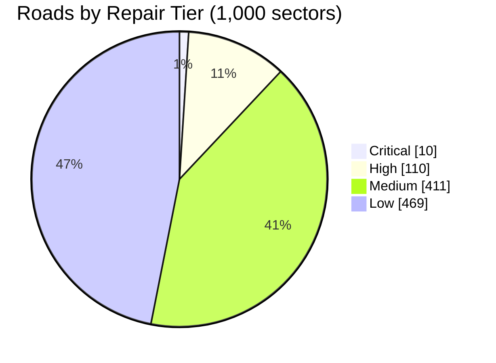

---

## 🎬 Live Product Tour

> ℹ️ *The sci-fi HUD styling (classification banners, orbital readouts) is purely decorative theming for the cockpit. No classified or private data is used anywhere.*

<div align="center">

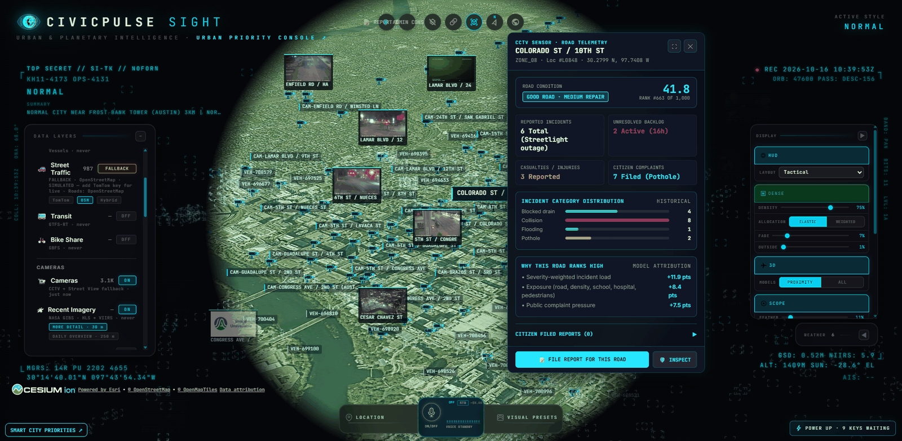

*Street-level cockpit: live CCTV thumbnails, vehicle telemetry and the explainable road-telemetry panel for **Colorado St / 10th St**.*

</div>

### 🌍 1 · From planet to street

<table>
<tr>
<td width="50%">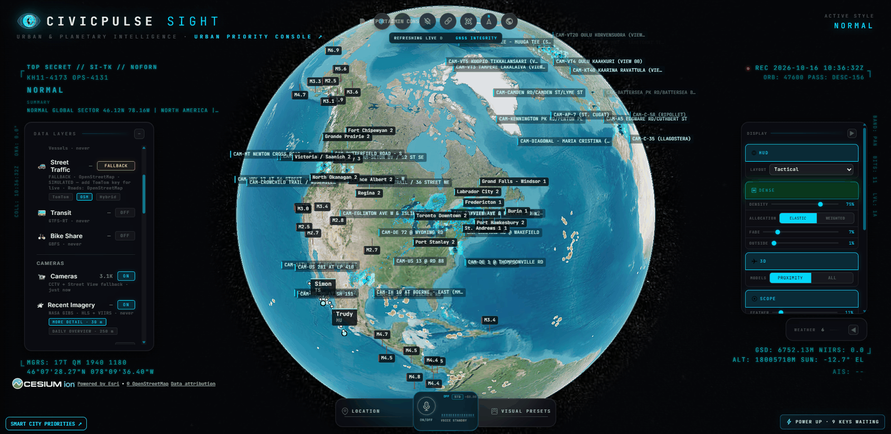<br/><sub><b>Planetary view</b> — global CCTV mesh, seismic markers, weather radar and GNSS integrity on a CesiumJS globe.</sub></td>
<td width="50%">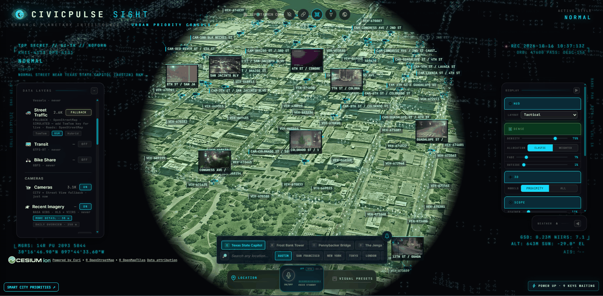<br/><sub><b>City view (Austin, TX)</b> — photoreal 3D buildings, camera thumbnails and live vehicle layer; quick-jump presets for landmarks and cities.</sub></td>
</tr>
</table>

### 🧠 2 · Explainable road intelligence

<table>
<tr>
<td width="50%">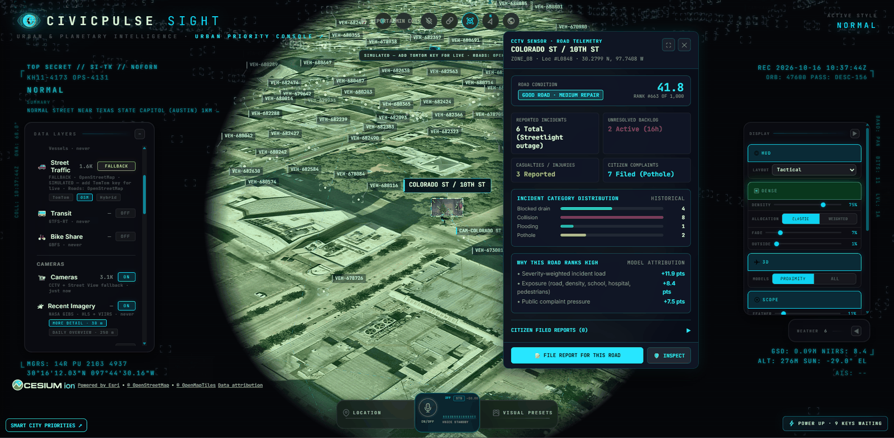<br/><sub><b>Road telemetry panel</b> — condition, rank (#663 of 1,000), incident &amp; complaint counts, category distribution and <b>model attribution in points</b>.</sub></td>
<td width="50%">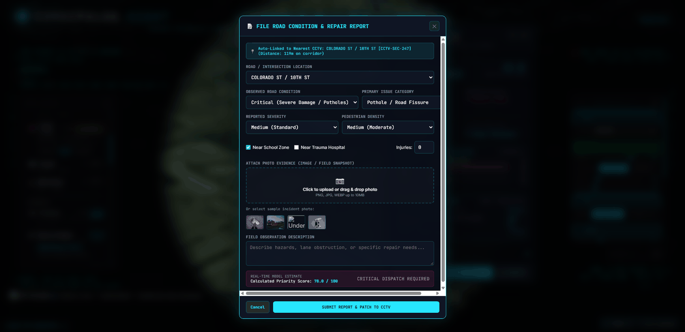<br/><sub><b>Citizen / field report modal</b> — auto-links nearest CCTV (119 m), captures severity, pedestrian density, school / trauma-hospital proximity, photo evidence, and shows a <b>real-time priority estimate (78.0 / 100 → CRITICAL DISPATCH REQUIRED)</b>.</sub></td>
</tr>
</table>

### 🚦 3 · Priority queue &amp; dispatch

<table>
<tr>
<td width="50%">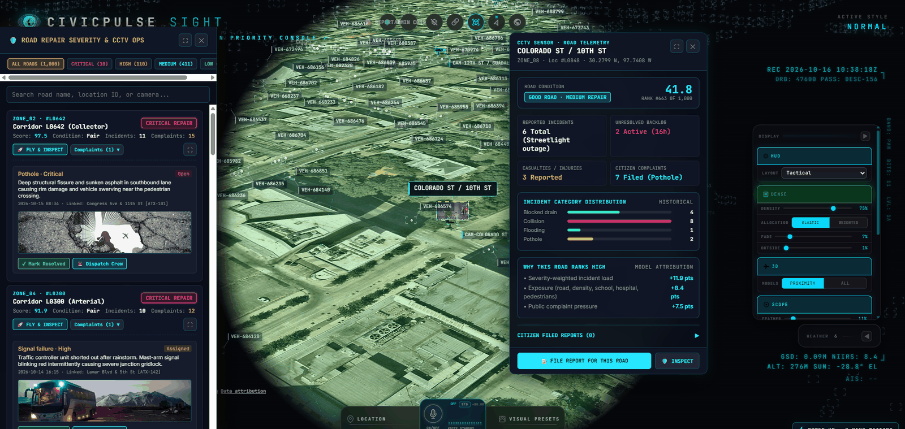<br/><sub><b>Road Repair Severity &amp; CCTV Ops</b> — tier filters (Critical 10 · High 110 · Medium 411 · Low 469), search by road / ID / camera, per-incident <i>Fly &amp; Inspect</i>, <i>Mark Resolved</i>, <i>Dispatch Crew</i>.</sub></td>
<td width="50%">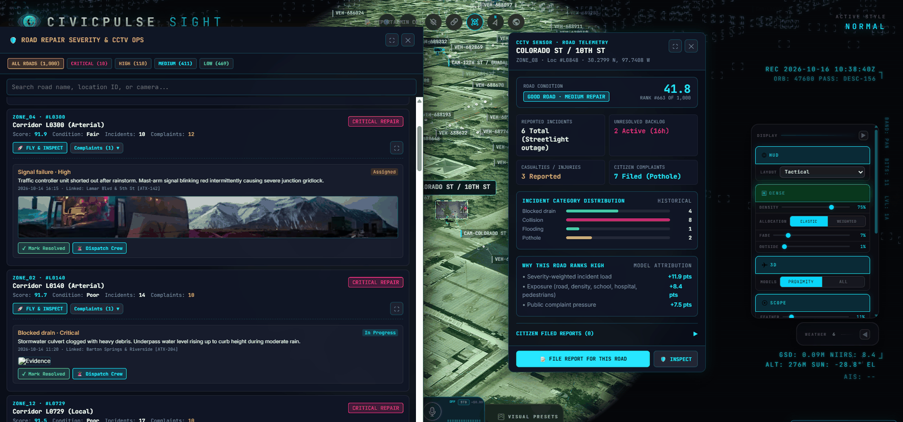<br/><sub><b>Expanded queue</b> — full-width triage list with evidence photos, status chips (Open / Assigned / In Progress) and linked intersections.</sub></td>
</tr>
</table>

### 📹 4 · Live traffic &amp; CCTV mesh

<table>
<tr>
<td width="50%">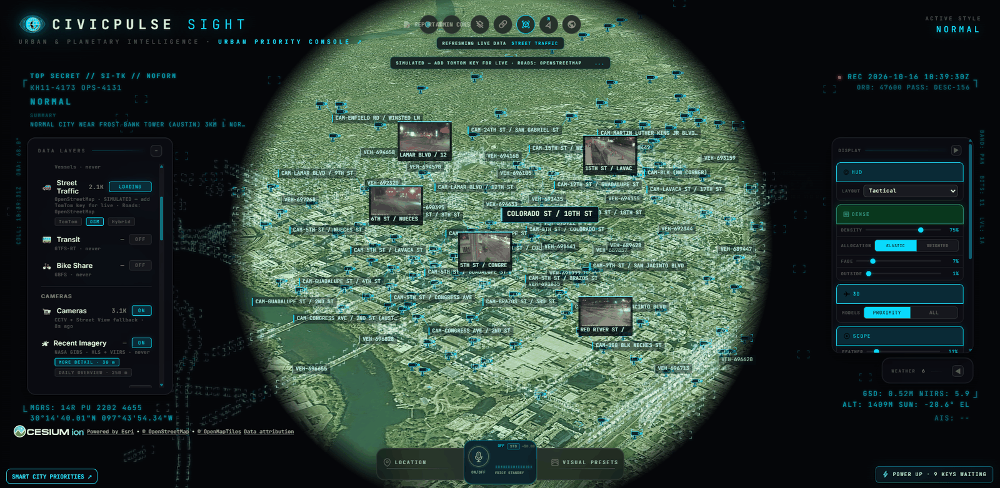<br/><sub><b>Street traffic layer + camera frustums</b> — dense camera mesh with labelled intersections and simulated vehicle flow (live with a TomTom key).</sub></td>
<td width="50%"><br/><sub><b>Camera-to-telemetry hand-off</b> — click a camera and the telemetry dossier for that road opens instantly.</sub></td>
</tr>
</table>

### 📈 5 · Triage audit — *show your work*

<table>
<tr>
<td width="50%">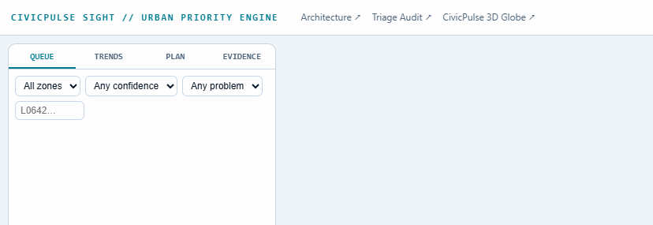<br/><sub><b>Urban Priority Engine</b> — <code>QUEUE · TRENDS · PLAN · EVIDENCE</code> tabs with zone / confidence / problem filters and road-ID search.</sub></td>
<td width="50%">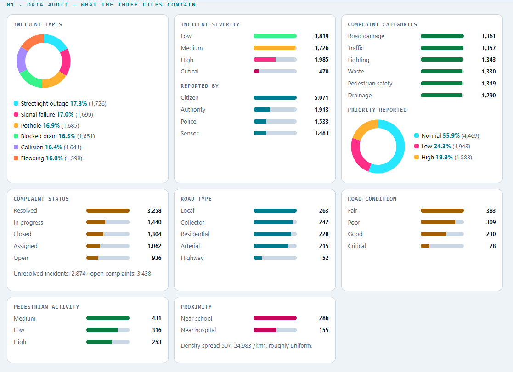<br/><sub><b>01 · Data audit</b> — what the three files contain: incident types, severity, reporters, complaint status, road mix, proximity.</sub></td>
</tr>
<tr>
<td width="50%">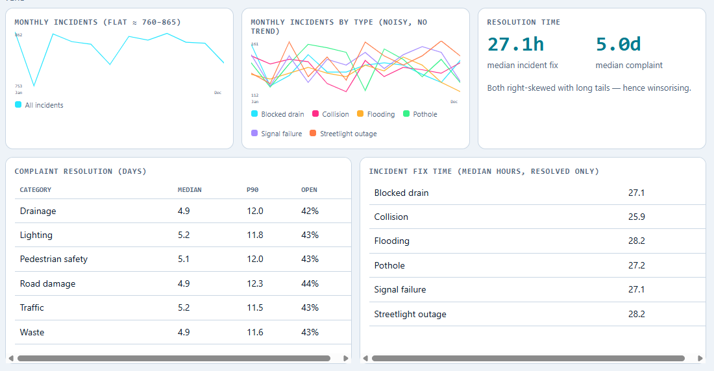<br/><sub><b>Trends</b> — monthly incidents (flat ≈ 760–865), fix times and complaint resolution percentiles.</sub></td>
<td width="50%">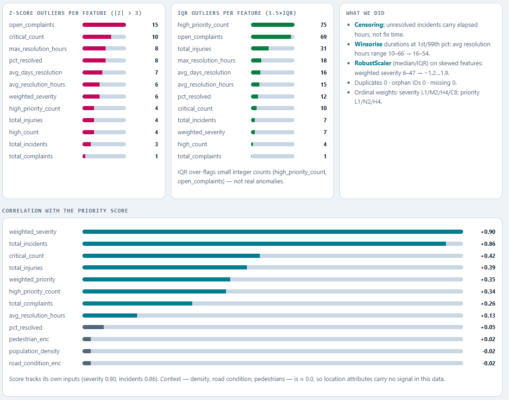<br/><sub><b>Outliers &amp; correlation</b> — Z-score vs IQR outlier counts, preprocessing decisions and feature-to-score correlation.</sub></td>
</tr>
</table>

---

## ✨ Feature Matrix

<div align="center">

| | Capability | What it does | Where |
|:-:|:--|:--|:--|
| 🎯 | **Explainable priority score** | 0–100 composite from 6 weighted pillars, with per-road point attribution | Telemetry panel, Priority Engine |
| 🧮 | **Robust preprocessing** | Right-censoring, 1st/99th winsorization, RobustScaler, empirical-Bayes shrinkage | `training/` |
| 🔁 | **Stability testing** | 200× Poisson bootstrap → 10–90th rank interval + P(Top-50) | `training/` |
| 🧠 | **Auditable surrogate models** | Ridge / ElasticNet / Lasso / OLS coefficients, plus RF, Logistic, hybrid spatial ensemble | `training/train_all_models.py` |
| 🌍 | **3D digital twin** | CesiumJS globe → city → street, OSM 3D buildings, photoreal tiles | `/` |
| 📹 | **CCTV mesh** | 3.1K cameras, health-coloured markers, viewing frustums, auto-patrol hop | Cameras layer |
| 🚗 | **Traffic telemetry** | Street traffic layer (OSM roads; live via TomTom key), congestion overlay | Data Layers |
| 🛰️ | **Recent imagery** | NASA GIBS (HLS + VIIRS) overlays, 30 m detail + 250 m daily overview | Data Layers |
| 📝 | **Citizen report flow** | Modal auto-links nearest CCTV, live priority estimate, photo evidence upload | *File Report for this Road* |
| 🚒 | **Dispatch actions** | *Fly &amp; Inspect*, *Mark Resolved*, *Dispatch Crew* per incident | Priority queue |
| 🎙️ | **Voice navigation** | Hands-free natural-language map control | `src/voice/` |
| 🎛️ | **Tactical HUD** | Density / allocation / fade / scope sliders, visual presets, layout modes | Right dock |
| 📊 | **Triage audit page** | Data audit, trends, outliers, correlations, validation | `/audit.html` |
| 🔒 | **Secure by default** | Keys, tokens and `.env*` blocked by `.gitignore` | repo root |

</div>

---

## 🏗️ System Architecture

<div align="center">
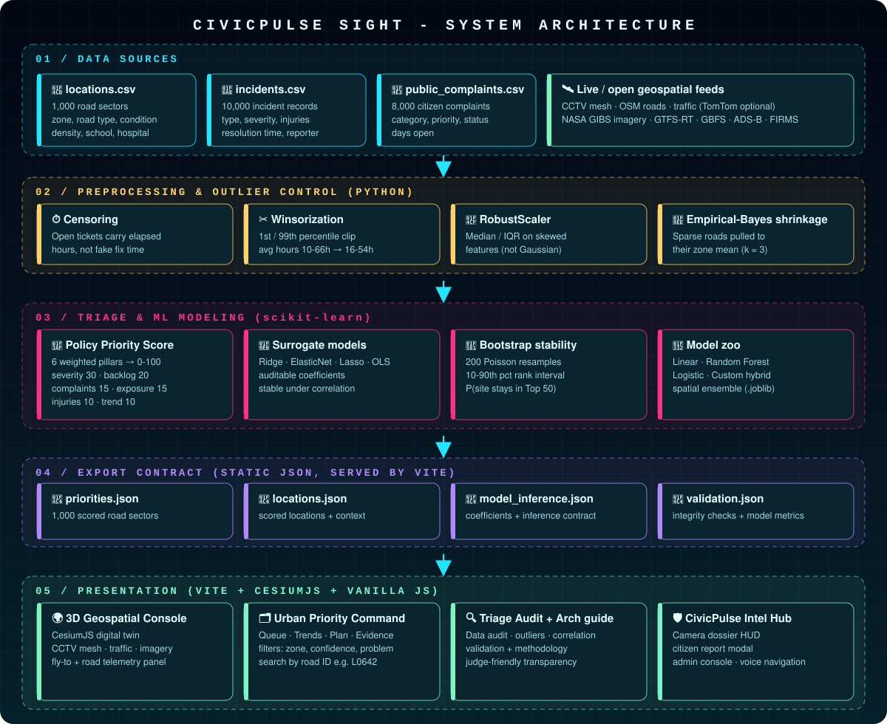
</div>

### 🔄 End-to-end data flow

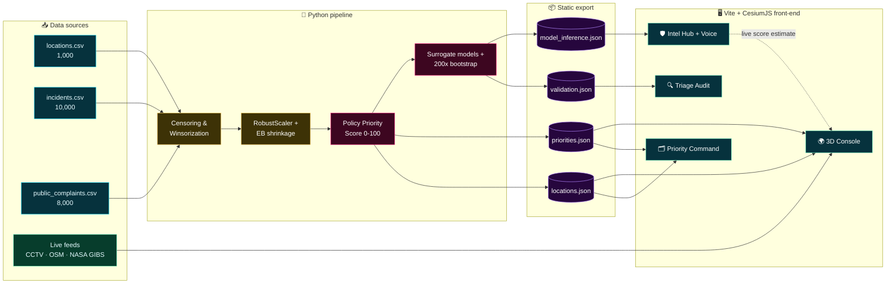

### 🧱 Layer-by-layer explanation

| # | Layer | Responsibility | Key decisions | Output |
|:-:|:--|:--|:--|:--|
| **1** | 📥 **Data ingestion** | Load the three track datasets (+ optional live geospatial feeds) | Joined on location ID; 0 duplicates, 0 orphan IDs, 0 missing | Clean frames |
| **2** | 🧹 **Preprocessing** | Make skewed, censored operational data safe to model | *Censor* open tickets, *winsorize* durations at 1st/99th pct, *RobustScaler* on skewed features, *EB-shrink* sparse roads to zone mean | Stable features |
| **3** | 🎯 **Scoring** | Turn features into one defendable number | 6 policy pillars with explicit weights; severity weights L1/M2/H4/C8; priority weights L1/N2/H4 | 0–100 score + tier |
| **4** | 🧠 **Modelling & validation** | Prove the ranking is stable and explainable | Linear surrogates for auditability, RF / Logistic / hybrid ensemble for comparison, 200× Poisson bootstrap | Coefficients, rank intervals, metrics |
| **5** | 📦 **Export contract** | Freeze results into static JSON the UI can load with zero backend | Versionable, cacheable, diff-able | `priorities / locations / model_inference / validation` |
| **6** | 🖥️ **Presentation** | Let a dispatcher *see*, *drill into* and *act on* priorities | CesiumJS cockpit + Priority Command + Audit pages, all Vite-served | Interactive UI |
| **7** | 🛡️ **Intel Hub** | Camera dossier, citizen complaints, admin console, report modal | Live in-browser score estimate from exported coefficients | Dispatch-ready reports |

### 🔁 Citizen report → dispatch sequence

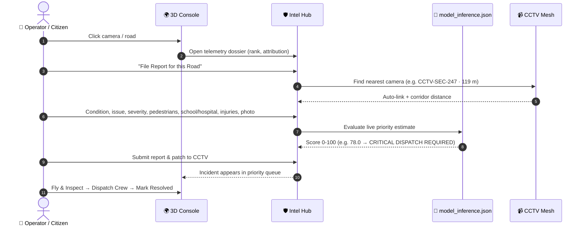

---

## 🔬 Data Science &amp; ML Pipeline

End-to-end, reproducible, and auditable — see [`training/smart_city_analysis.ipynb`](training/smart_city_analysis.ipynb).

### 1 · Ingested datasets

| 📁 File | Rows | Key columns |
|:--|--:|:--|
| `locations.csv` | **1,000** | `latitude`, `longitude`, `zone` (ZONE_01–20), `road_type`, `road_condition`, `population_density`, `near_school`, `near_hospital`, `pedestrian_activity` |
| `incidents.csv` | **10,000** | `incident_type`, `severity`, `reported_by`, `resolution_time_hours`, `injuries` (2025 records) |
| `public_complaints.csv` | **8,000** | `category`, `priority`, `status`, `days_open` |

### 2 · What the data audit found

<table>
<tr>
<td valign="top" width="33%">

**🚨 Incident types**

| Type | Count |
|:--|--:|
| Streetlight outage | 1,726 |
| Signal failure | 1,699 |
| Pothole | 1,685 |
| Blocked drain | 1,651 |
| Collision | 1,641 |
| Flooding | 1,598 |

</td>
<td valign="top" width="33%">

**⚠️ Severity &amp; reporter**

| Severity | Count |
|:--|--:|
| Low | 3,819 |
| Medium | 3,726 |
| High | 1,985 |
| 🔴 Critical | 470 |

| Reported by | Count |
|:--|--:|
| Citizen | 5,071 |
| Authority | 1,913 |
| Police | 1,533 |
| Sensor | 1,483 |

</td>
<td valign="top" width="33%">

**📣 Complaint status**

| Status | Count |
|:--|--:|
| Resolved | 3,258 |
| In progress | 1,440 |
| Closed | 1,304 |
| Assigned | 1,062 |
| Open | 936 |

Unresolved incidents **2,874** · open complaints **3,438**

</td>
</tr>
<tr>
<td valign="top">

**🛣️ Road type**

| Type | Roads |
|:--|--:|
| Local | 263 |
| Collector | 242 |
| Residential | 228 |
| Arterial | 215 |
| Highway | 52 |

</td>
<td valign="top">

**🚧 Road condition**

| Condition | Roads |
|:--|--:|
| Fair | 383 |
| Poor | 309 |
| Good | 230 |
| Critical | 78 |

</td>
<td valign="top">

**🏫 Exposure context**

| Signal | Value |
|:--|--:|
| Near school | 286 |
| Near hospital | 155 |
| Ped. activity — Medium | 431 |
| Ped. activity — Low | 316 |
| Ped. activity — High | 253 |

Density 507–24,983 /km²

</td>
</tr>
</table>

### 3 · Outlier handling &amp; preprocessing

| Technique | Applied to | Effect |
|:--|:--|:--|
| 🔎 **Z-score** (\|z\| > 3) &amp; **IQR** (1.5×) | All aggregated features | Dual detection; IQR over-flags small integer counts, so those are treated as *not real anomalies* |
| ⏱️ **Right-censoring** | Unresolved incidents | Carry elapsed hours, **not** a fake fix time |
| ✂️ **Winsorization** (1st / 99th pct) | Duration metrics | Avg resolution hours **10–66 → 16–54** |
| 📏 **RobustScaler** (median / IQR) | Skewed features | Weighted severity **6–47 → −1.2…1.9** |
| 🧮 **Empirical-Bayes shrinkage** | Sparse locations | Pulled toward the zone mean (formula below) |

$$\hat{\theta}_i = \frac{n_i \cdot \bar{x}_i + 3 \cdot \mu_{\text{zone}}}{n_i + 3}$$

<details>
<summary><b>📉 Top outlier counts per feature (click to expand)</b></summary>

| Feature | Z-score | IQR |
|:--|--:|--:|
| `open_complaints` | 15 | 69 |
| `critical_count` | 10 | 10 |
| `max_resolution_hours` | 8 | 18 |
| `pct_resolved` | 8 | 12 |
| `avg_days_resolution` | 7 | 16 |
| `avg_resolution_hours` | 6 | 15 |
| `weighted_severity` | 6 | 7 |
| `high_priority_count` | 4 | 75 |
| `total_injuries` | 4 | 31 |
| `high_count` | 4 | 4 |
| `total_incidents` | 3 | 7 |
| `total_complaints` | 1 | 1 |

</details>

### 4 · Transparent priority formulation

<div align="center">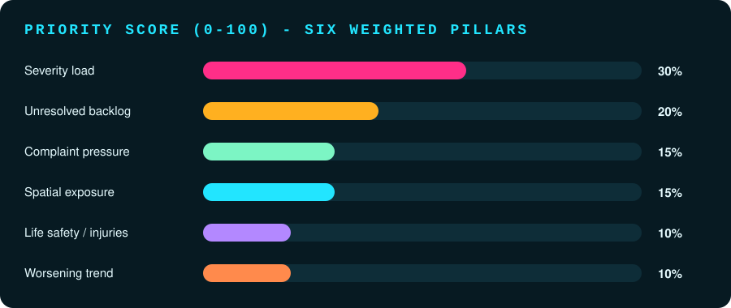</div>

| Pillar | Weight | How it is computed |
|:--|:-:|:--|
| ⚠️ **Severity load** | **30%** | Exponentially weighted severity (Low 1 · Med 2 · High 4 · Critical 8) with a **120-day half-life** decay |
| ⏳ **Unresolved backlog** | **20%** | Right-censored active hours of pending / aging incidents |
| 📣 **Complaint pressure** | **15%** | Weighted volume of active citizen complaints (priority L1 · N2 · H4) |
| 🏫 **Spatial exposure** | **15%** | Schools, trauma hospitals, pedestrian activity, population density |
| 🚑 **Life safety** | **10%** | Injury / casualty counts from collisions and structural incidents |
| 📈 **Worsening trend** | **10%** | Positive slope of incident counts over preceding quarters |

**Worked example — Colorado St / 10th St (score 41.8, rank #663 / 1,000):**

| Attribution | Points |
|:--|--:|
| Severity-weighted incident load | **+11.9** |
| Exposure (road, density, school, hospital, pedestrians) | **+8.4** |
| Public complaint pressure | **+7.5** |

### 5 · Surrogate &amp; comparison models

| Model | Role |
|:--|:--|
| **Ridge** (ℓ2) | Stable shrinkage; feature ranking *without* zeroing correlated urban-risk indicators |
| **ElasticNet / Lasso / OLS** | Sparsity and baseline comparisons |
| **Random Forest** | Non-linear feature importance &amp; confusion matrix |
| **Logistic Regression** | Critical-vs-not classification with ROC curves |
| **Custom hybrid spatial ensemble** | Blends spatial context with tabular signals |
| **200× Poisson bootstrap** | 10th–90th percentile rank intervals + exact P(site stays in Top 50) |

Side-by-side plots: [`training/models_comparison_matrix.png`](training/models_comparison_matrix.png).

### 6 · Honest findings from the audit

| 🔍 Finding | 📊 Evidence | 🧭 Design response |
|:--|:--|:--|
| Score tracks its own inputs | Corr. with score: weighted severity **+0.90**, total incidents **+0.86** | Severity gets the largest weight (30%) |
| Location context carries ≈ 0 linear signal | density −0.02 · road condition −0.02 · pedestrians +0.02 | Exposure enters as an explicit, *visible* policy weight rather than a hidden learned effect |
| No seasonality in incidents | Monthly incidents flat ≈ 760–865 | Trend pillar kept small (10%) |
| Fix speed is uniform across types | Median fix 25.9–28.2 h (collision fastest, flooding / streetlight slowest) | Ranking driven by risk, not by “easy wins” |
| Backlog is uniform across categories | ~42–44% of complaints open in every category; median 5.0 days, P90 ≈ 12 days | Backlog must be *prioritized*, not just worked in FIFO order |

<details>
<summary><b>🔗 Full correlation-with-score table (click to expand)</b></summary>

| Feature | Corr. | Feature | Corr. |
|:--|--:|:--|--:|
| `weighted_severity` | **+0.90** | `total_complaints` | +0.26 |
| `total_incidents` | **+0.86** | `avg_resolution_hours` | +0.13 |
| `critical_count` | +0.42 | `pct_resolved` | +0.05 |
| `total_injuries` | +0.39 | `pedestrian_enc` | +0.02 |
| `weighted_priority` | +0.35 | `population_density` | −0.02 |
| `high_priority_count` | +0.34 | `road_condition_enc` | −0.02 |

</details>

---

## 🌐 3D Geospatial Console &amp; CCTV Mesh

A high-performance **CesiumJS** cockpit that turns the ranking into something an operator can *see and act on*.

### 🗂️ Data layers

| Layer | Source | Status in demo | Notes |
|:--|:--|:-:|:--|
| 🚗 **Street Traffic** | OpenStreetMap roads · TomTom (optional) | 🟡 Simulated / fallback | Add a TomTom key for live flow |
| 📹 **Cameras** | CCTV mesh + Street View fallback | 🟢 On (3.1K) | Frustums, viewsheds, health colours |
| 🛰️ **Recent Imagery** | NASA GIBS · HLS + VIIRS | 🟢 On | 30 m detail · 250 m daily overview |
| 🚆 **Transit** | GTFS-RT | ⚪ Off | Toggle in Data Layers |
| 🚲 **Bike Share** | GBFS | ⚪ Off | Toggle in Data Layers |
| 🚢 **Vessels / ✈️ ADS-B / 🔥 FIRMS** | Public feeds | ⚪ Optional | Provider modules in `src/layers/` |
| 🌋 **Seismic · 🌦️ Weather · 📡 GNSS** | Public feeds | 🟢 On | Visible in the planetary view |

### 🎛️ Cockpit controls

| Control | Options |
|:--|:--|
| **HUD layout** | Tactical (default) and alternates |
| **Density / Allocation** | 0–100% slider · Elastic ⇄ Weighted |
| **Fade / Outside / Scope** | Fine-tune overlay visibility |
| **3D models** | Proximity ⇄ All |
| **Quick locations** | Texas State Capitol · Frost Bank Tower · Pennybacker Bridge · The Jenga · Austin · San Francisco · New York · Tokyo · London |
| **Voice** | ON/OFF hands-free navigation |
| **Visual presets** | Style switcher (active: *Normal*) |

### 🚦 Priority tiers &amp; workflow

| Tier | Roads | Typical action |
|:--|--:|:--|
| 🔴 **Critical** | 10 | Immediate dispatch |
| 🟠 **High** | 110 | Schedule this cycle |
| 🟡 **Medium** | 411 | Planned maintenance |
| 🟢 **Low** | 469 | Monitor |

**Top critical corridors (from the live queue):**

| Rank | Corridor | Class | Score | Condition | Incidents | Complaints |
|:-:|:--|:--|--:|:--|--:|--:|
| 1 | `L0642` | Collector | **97.5** | Fair | 11 | 15 |
| 2 | `L0300` | Arterial | **91.9** | Fair | 10 | 12 |
| 3 | `L0140` | Arterial | **91.7** | Poor | 14 | 10 |
| 4 | `L0729` | Local | **91.5** | Poor | 17 | 10 |

---

## 🔌 API &amp; Data Endpoints

CivicPulse Sight ships as a **zero-backend static build**: the Python pipeline exports versioned JSON and the Vite app serves it. Below is the full surface — what exists today, which external services it talks to, and the production REST contract we designed for the next step.

> Base URL in development: **`http://localhost:4173`**

### 🟢 A · Application routes (implemented)

| Method | Route | Page | Purpose |
|:-:|:--|:--|:--|
| `GET` | `/` | 🌍 3D Geospatial Console | CesiumJS cockpit with CCTV, traffic, imagery, telemetry |
| `GET` | `/smartcity/index.html` | 🗂️ Urban Priority Command Center | Queue · Trends · Plan · Evidence |
| `GET` | `/audit.html` | 🔍 Triage Audit &amp; Validation | Data audit, outliers, correlations, model validation |
| `GET` | `/smartcity/architecture.html` | 📐 Architecture Guide | Pipeline specification &amp; methodology |

### 🟢 B · Data endpoints (implemented, static JSON)

| Method | Endpoint | Returns | Consumed by |
|:-:|:--|:--|:--|
| `GET` | `/smartcity/data/priorities.json` | Ranked **1,000** municipal road sectors with scores &amp; tiers | Priority Command, Console |
| `GET` | `/smartcity/data/locations.json` | Scored locations with spatial context | Console, Telemetry panel |
| `GET` | `/smartcity/data/model_inference.json` | Exported model coefficients + **inference contract** | Intel Hub live score estimator |
| `GET` | `/smartcity/data/validation.json` | Integrity checks + model metrics | Triage Audit |

**Fields surfaced to the UI per road sector** *(see screenshots above)*:

| Field | Example | Shown in |
|:--|:--|:--|
| Location ID | `L0642` | Queue, telemetry header |
| Zone | `ZONE_02` | Queue card |
| Road class | `Collector` | Queue card |
| Priority score / rank | `97.5` / `#663 of 1,000` | Queue, telemetry |
| Condition + repair tier | `Good Road · Medium Repair` | Telemetry |
| Incidents / complaints / casualties | `11` / `15` / `3` | Telemetry |
| Attribution (points) | `+11.9`, `+8.4`, `+7.5` | “Why this road ranks high” |

```js
// Load the exported priorities and show the top 5
const res = await fetch('/smartcity/data/priorities.json');
const roads = await res.json();
console.table(roads.slice(0, 5));
```

> ⚠️ Field names above mirror what the UI displays. Check the exact keys in the exported JSON before building on them.

### 🛰️ C · External services

| Service | Used for | Key needed? |
|:--|:--|:-:|
| **Cesium ion** | Globe, terrain, 3D tiles | 🔑 Token |
| **OpenStreetMap / OSM 3D buildings** | Road network, building volumes | ❌ No |
| **TomTom Traffic** | Live traffic flow | 🔑 Optional (simulated fallback without it) |
| **NASA GIBS** (HLS, VIIRS) | Recent satellite imagery | ❌ No |
| **GTFS-RT / GBFS** | Transit &amp; bike-share layers | Provider dependent |
| **ADS-B / NASA FIRMS** | Aircraft &amp; fire layers | Provider dependent |
| **CCTV feeds + Street View fallback** | Camera mesh imagery | Provider dependent |

Keys live in your local, git-ignored `.env` files (see [Security](#-security--privacy)). The cockpit's *“Power Up · 9 keys waiting”* chip lists which optional keys are still missing.

### 🧩 D · Front-end module interfaces

| Module | Path | Responsibility |
|:--|:--|:--|
| Cockpit bootstrap | `src/main.js` | Cesium init, camera controllers |
| Intel Hub | `src/civicpulse/civicpulse-intel.js` | Camera dossier HUD, citizen complaints, admin console, report modal |
| Layer providers | `src/layers/` | CCTV, Traffic, ADS-B, FIRMS |
| UI chrome | `src/ui/` | HUD, docks, templates |
| Voice | `src/voice/` | Natural-language map navigation |

### 🔵 E · Planned production REST API (roadmap contract)

Designed 1:1 from the actions already present in the UI, so the front-end can switch from static JSON to a live service without redesign. **Not part of the current static build.**

| Method | Endpoint | Maps to UI action |
|:-:|:--|:--|
| `GET` | `/api/v1/priorities?zone=&tier=&q=&limit=&cursor=` | Priority queue filters &amp; search |
| `GET` | `/api/v1/priorities/{locationId}` | Telemetry panel |
| `GET` | `/api/v1/priorities/{locationId}/explain` | *Why this road ranks high* |
| `GET` | `/api/v1/cameras/nearest?lat=&lng=` | Auto-link nearest CCTV |
| `POST` | `/api/v1/reports` | *Submit report &amp; patch to CCTV* |
| `PATCH` | `/api/v1/reports/{id}` | *Mark Resolved* |
| `POST` | `/api/v1/dispatches` | *Dispatch Crew* |
| `GET` | `/api/v1/validation` | Triage Audit page |

<details>
<summary><b>📨 Example: <code>POST /api/v1/reports</code> (click to expand)</b></summary>

**Request**

```json
{
  "location": "COLORADO ST / 10TH ST",
  "observedCondition": "Critical (Severe Damage / Potholes)",
  "issueCategory": "Pothole / Road Fissure",
  "reportedSeverity": "Medium",
  "pedestrianDensity": "Medium",
  "nearSchoolZone": true,
  "nearTraumaHospital": false,
  "injuries": 0,
  "description": "Deep fissure in southbound lane near the crossing.",
  "photoEvidence": "<multipart upload: PNG | JPG | WEBP, max 10 MB>"
}
```

**Response `201 Created`**

```json
{
  "reportId": "RPT-000123",
  "linkedCamera": { "id": "CCTV-SEC-247", "distanceMeters": 119 },
  "priorityScore": 78.0,
  "dispatch": "CRITICAL DISPATCH REQUIRED",
  "status": "Open"
}
```

</details>

---

## 📂 Project Structure

<details open>
<summary><b>Repository layout</b></summary>

```plaintext
SmartCity/
├── README.md                        # You are here
├── PRD.md                           # Product requirements & design specification
├── TECH_STACK.md                    # Architecture components & runtime licenses
├── .gitignore                       # Multi-layer security & ignore rules
├── package.json                     # Scripts & dependencies
├── vite.config.js                   # Vite server & proxy config
├── index.html                       # 3D cockpit entrypoint (CesiumJS)
├── triage-audit.html                # Standalone triage & validation engine
├── style.css                        # Global cockpit styles
├── deploy.bat | deploy.command | deploy.sh   # 1-click launchers (Win / macOS / Unix)
│
├── docs/                            # README media
│   ├── assets/                      # banner.svg, architecture.svg, score-pillars.svg
│   └── screenshots/                 # Product tour images
│
├── 03_smart_city_where_fix_first/   # Datathon 2026 track datasets
│   ├── locations.csv                # 1,000 spatial + contextual rows
│   ├── incidents.csv                # 10,000 historical incident records
│   └── public_complaints.csv        # 8,000 citizen complaint submissions
│
├── training/                        # Data-science & regularization pipeline
│   ├── train_all_models.py          # Ridge, RF, Logistic, Custom training pipeline
│   ├── models_comparison_matrix.png # 4-panel side-by-side model comparison
│   ├── linear_regression/           # plots + model/linear_regression_model.joblib
│   ├── random_forest/               # importances, confusion matrix + joblib
│   ├── logistic_regression/         # ROC, confusion matrix + joblib
│   ├── custom_model/                # hybrid spatial ensemble + joblib
│   ├── build_nb.py                  # Reproducible notebook generator
│   └── smart_city_analysis.ipynb    # Interactive EDA + multi-model comparison
│
├── public/
│   ├── manifest.webmanifest         # PWA configuration
│   ├── audit.html                   # Full triage audit interface
│   └── smartcity/                   # Urban Priority Engine UI & data
│       ├── index.html               # Triage map & priority ranking UI
│       ├── architecture.html        # Pipeline spec & methodology
│       ├── training_plots/          # Mirrored model evaluation plots
│       └── data/
│           ├── locations.json       # Exported scored locations
│           ├── priorities.json      # 1,000 municipal road sectors
│           ├── model_inference.json # Model coefficients & inference contract
│           └── validation.json      # Integrity checks & model metrics
│
└── src/
    ├── main.js                      # Cesium init & camera controllers
    ├── civicpulse/                  # CivicPulse Intel Hub
    │   ├── civicpulse-intel.js      # Dossier HUD, complaints, admin console
    │   └── civicpulse-ui.css        # Glassmorphism, reticle & expand modal
    ├── layers/                      # CCTV, Traffic, ADS-B, FIRMS providers
    ├── ui/                          # Dark sci-fi chrome, HUD, dock templates
    └── voice/                       # Hands-free map navigation
```

</details>

---

## 🚀 Quick Start

### ✅ Prerequisites

| Tool | Version |
|:--|:--|
| 🟩 Node.js | `v20+` (Node 24 recommended) |
| 🐍 Python | `3.10+` with `pip` |
| 🌐 Browser | WebGL 2.0 — Chrome, Edge, Firefox, Brave |

### ⚡ One-click launch

| OS | Command |
|:-:|:--|
| 🪟 **Windows** | Double-click or run `deploy.bat` |
| 🍎 **macOS** | Double-click `deploy.command` *(or `./deploy.sh`)* |
| 🐧 **Linux** | `./deploy.sh` |

The launcher verifies Node.js → runs `npm install` if needed → prints all live links → opens `http://localhost:4173/` → starts the Vite + Cesium server.

### 💻 Manual launch

```bash
npm install
npm run dev
```

| 🔗 Open | URL |
|:--|:--|
| 🌍 3D Geospatial Console | http://localhost:4173/ |
| 🗂️ Urban Priority Command Center | http://localhost:4173/smartcity/index.html |
| 🔍 Triage Audit &amp; Validation | http://localhost:4173/audit.html |
| 📐 Architecture Guide | http://localhost:4173/smartcity/architecture.html |

### 🐍 Reproduce the ML pipeline

```bash
pip install numpy pandas matplotlib seaborn scipy scikit-learn jupyterlab
python training/build_nb.py                       # regenerate the notebook
jupyter lab training/smart_city_analysis.ipynb    # explore EDA + models
python training/train_all_models.py               # retrain all models
```

---

## 🏆 For Judges — Where to Look

| 🎯 Criterion | ✅ What we deliver | 👀 See it |
|:--|:--|:--|
| **Problem fit** | Direct answer to *“Where should we fix first?”* with one ranked list of 1,000 roads | [Priority queue](#-3--priority-queue--dispatch) |
| **Technical depth** | Censoring, winsorization, robust scaling, EB shrinkage, 200× bootstrap, 4+ model families | [ML pipeline](#-data-science--ml-pipeline) |
| **Explainability** | Per-road attribution in points, auditable linear surrogates, public audit page | [Worked example](#4--transparent-priority-formulation) |
| **Rigor &amp; honesty** | We publish what the data *doesn't* support (≈ 0 context correlation, flat trend) | [Findings](#6--honest-findings-from-the-audit) |
| **UX &amp; wow factor** | Planet → city → street digital twin, CCTV mesh, voice control | [Product tour](#-live-product-tour) |
| **Actionability** | Report → live score → CCTV link → dispatch → resolve | [Sequence](#-citizen-report--dispatch-sequence) |
| **Reproducibility** | One-click launchers, notebook generator, static JSON contract | [Quick start](#-quick-start) |
| **Scalability path** | Static JSON → REST contract already designed | [API roadmap](#-e--planned-production-rest-api-roadmap-contract) |

### ⏱️ 90-second demo script

1. 🌍 **Open `/`** — start on the globe, then jump to **Austin** from the quick-location bar.
2. 📹 **Click a camera** (e.g. *Colorado St / 10th St*) — telemetry panel opens with score, rank and attribution.
3. 📝 **File Report for this Road** — watch the nearest CCTV auto-link and the live score hit **CRITICAL DISPATCH REQUIRED**.
4. 🚒 **Open the priority queue** — filter *Critical*, hit **Fly &amp; Inspect**, then **Dispatch Crew**.
5. 🔍 **Open `/audit.html`** — show the data audit, outlier handling and correlation table.

---

## 🧰 Tech Stack

| Layer | Technology | Why |
|:--|:--|:--|
| 🎨 Front-end | **Vanilla JS + Vite 6** | Fast HMR, tiny runtime, no framework lock-in |
| 🌍 3D / Geo | **CesiumJS 1.124+** | Globe-scale WebGL 2 rendering, 3D Tiles |
| 🗺️ Map data | **OpenStreetMap**, NASA GIBS | Open, license-friendly geodata |
| 🐍 Data science | **Python 3.10+, pandas, NumPy, SciPy** | Reproducible analysis |
| 🤖 ML | **scikit-learn 1.4+** (Ridge, ElasticNet, Lasso, RF, Logistic) | Auditable models |
| 📓 Notebooks | **Jupyter** | Interactive EDA + model comparison |
| 📊 Plots | **Matplotlib, Seaborn** | Evaluation visuals |
| 📱 PWA | `manifest.webmanifest` | Installable console |
| 🧪 Delivery | Static JSON + 1-click launchers | Zero-backend demo |

---

## 🔒 Security &amp; Privacy

| 🛡️ Guarantee | Detail |
|:--|:--|
| **No dependency leakage** | `node_modules/` and build outputs are barred from version control |
| **Credentials blocked** | `*.pem`, `*.key`, `*.pfx`, `*.p12`, `*.p8`, `*.keystore`, `id_rsa*`, `id_ed25519*`, `service_account*.json`, `secrets.json`, `token.json`, `.env*` all ignored |
| **No private data** | All benchmarks use public datasets or sanitized synthetic research records |
| **Open licenses** | MIT core; CesiumJS, OpenStreetMap and public-domain cartography for geo tiles |

---

## 🗺️ Roadmap

| Status | Item |
|:-:|:--|
| ✅ | Explainable priority score + surrogate models + bootstrap stability |
| ✅ | 3D cockpit with CCTV mesh, traffic and imagery layers |
| ✅ | Citizen report modal with live score and CCTV auto-link |
| ✅ | Triage audit + architecture pages |
| 🔜 | Production REST API (contract in [section E](#-e--planned-production-rest-api-roadmap-contract)) |
| 🔜 | Live TomTom traffic + real CCTV ingestion |
| 🔜 | Crew scheduling optimizer (budget- and route-aware) |
| 🔜 | Multi-city onboarding &amp; role-based admin console |

---

## 📜 License &amp; Credits

- **Core application:** released under the [MIT License](LICENSE).
- **Geospatial tiles:** powered by CesiumJS, OpenStreetMap and public-domain cartography.
- **Built with precision by the CivicPulse Sight Team.**

<div align="center">

<br/>

**🏙️ CivicPulse Sight — fix the right road, first, and prove why.**

</div>
